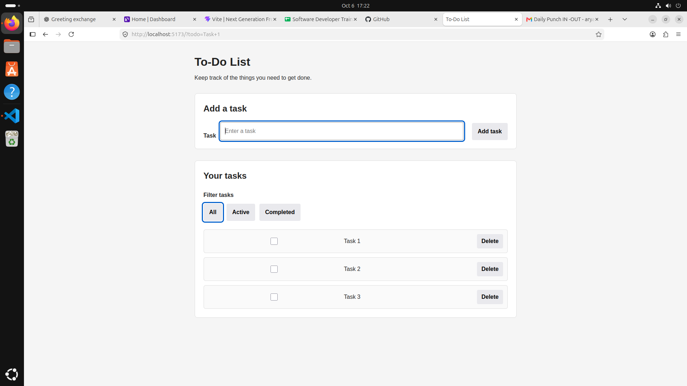
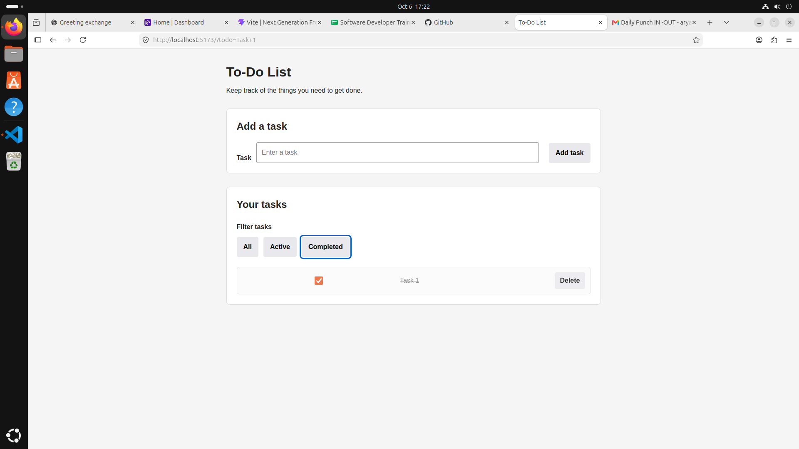
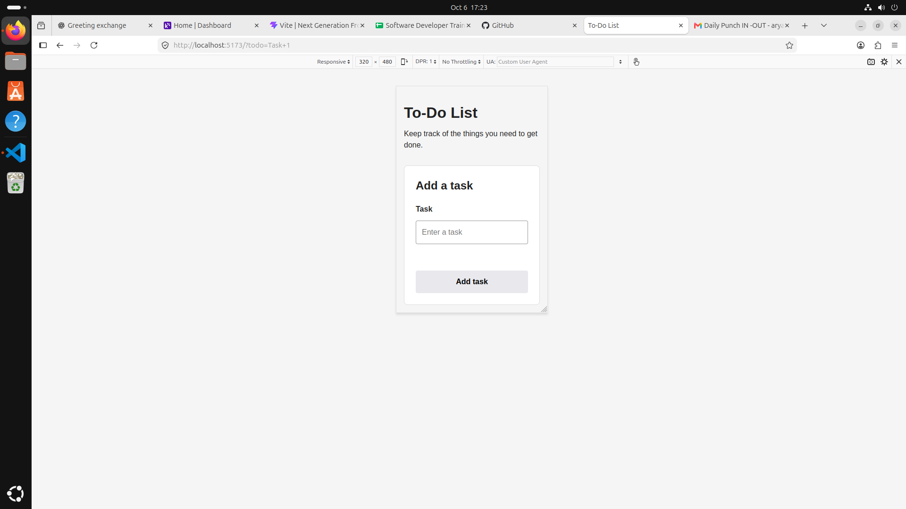
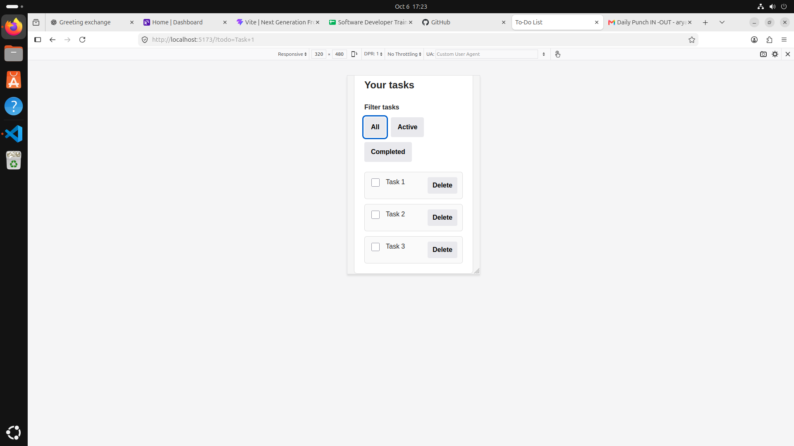

# To-Do List

An accessible and responsive To-Do List application built with semantic HTML, CSS, and vanilla TypeScript.

## Features

- Add new tasks
- Mark tasks as completed
- Delete tasks
- Filter tasks by:
  - All
  - Active
  - Completed
- Persist tasks using localStorage
- Input validation
- Empty states for each filter
- Accessible form labels and controls
- Keyboard-friendly interaction
- Responsive layout for desktop and mobile
- Strict TypeScript
- Modular TypeScript structure

## Technologies

- HTML5
- CSS3
- TypeScript
- Vite
- npm
- Git

## Project Structure

```text
todo-app/
├── public/
│   └── screenshots/
├── src/
│   ├── main.ts
│   ├── types.ts
│   ├── todo.ts
│   ├── storage.ts
│   └── style.css
├── index.html
├── package.json
├── package-lock.json
├── tsconfig.json
├── .gitignore
└── README.md

## Screenshots

### Desktop - All Tasks



### Desktop - Completed Tasks



### Mobile



### Mobile - All Tasks

